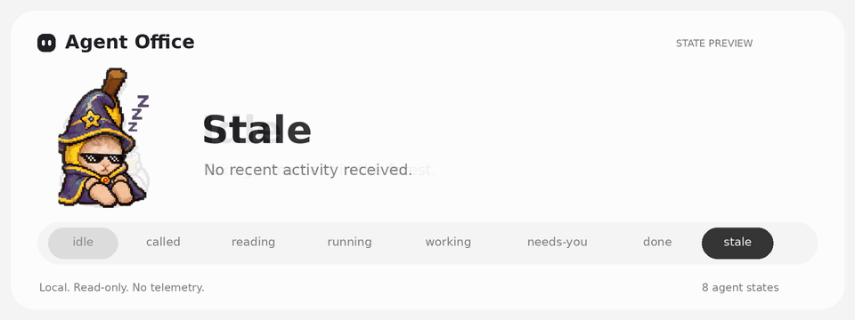
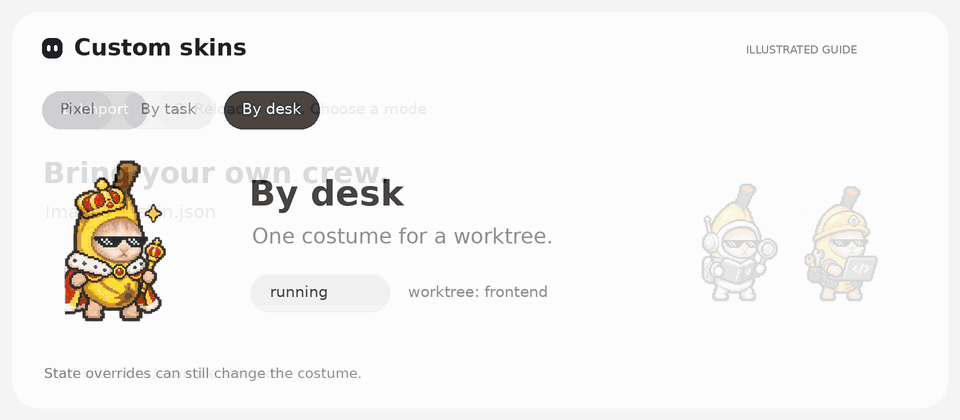
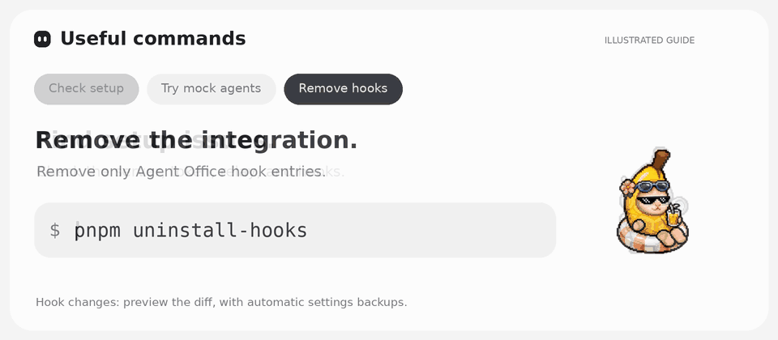

<h1 align="center">MON MANG</h1>

<p align="center">
  A local pixel office for your Claude Code and Codex agents in Orca.<br>
  <strong>Localhost only · No telemetry · Types to agents only when you send</strong>
</p>

<p align="center">
  
</p>

## Quick start

Requires **Node.js ≥22.12**, **pnpm ≥10**, `curl`, and **Claude Code with hooks** on macOS or Linux (WSL for Windows; untested).

```bash
pnpm install
pnpm start
```

In another terminal:

```bash
pnpm install-hooks
pnpm diagnose
```

Open **http://127.0.0.1:4777**, then start Claude Code in your Orca worktrees. Restart existing sessions after installing hooks. Keep `pnpm start` running. After updating MON MANG, run `pnpm install-hooks` again to add any new hooks.

## Features

- **MON MANG**, the assistant, is the home page: tell it what you want in plain words (Thai or English) and it answers from what the dashboard knows (projects and worktrees in Orca, every agent and its latest steps, your custom agents, today's usage and your Claude plan's limits) and lines up the actions. Harmless ones happen at once (theme, sound, desktop bananas, its own personality, opening an agent); anything that touches your agents or files waits on a button in the chat: starting Claude Code or Codex on a task (or **Edit in New task** to finish it there), typing to an agent or stopping it, creating a custom agent, turning on desktop alerts. Beside the chat: who needs you now and a summary button. Its **personality** is yours to set in **Settings → MON MANG** (or just ask it): buddy, professional, cheerful, mentor, brief or your own description; ครับ, ค่ะ or no ending; the language; what it calls you; emoji; and its color. It is kept in this browser and sent with each message. Each answer is a short read-only Codex turn (`codex exec`, sandboxed, nothing saved); only the dashboard acts on it, and only on ids the server knows. Off with `START_AGENTS=off`.
- Busy agents sit at desks in **Agent Work**; waiting agents relax around the campfire at **Base Camp**. Base Camp also keeps Claude Code and Codex launchers, plus saved custom helpers, ready for another task after a live session ends. Click one to open New task with that assistant selected. Collapse either half to give the other the full width.
- A sidebar down the left edge (collapse it to icons with the button beside the name; remembered) switches between **New task**, **Office**, **Agents**, **Usage**, **Custom agents** and **Settings**; its **Focus** group jumps straight to who needs you, who is working and who is resting. Each page has its own address (`/?page=agents`), so a reload or the Back button keeps your place.
- The foot of the sidebar shows the Claude account your agents run on and how much of its usage is left (this 5-hour session and this week, with when each resets), as Orca reports it; the ring around its initial fills with the session. Open it to see every Claude account Orca knows, the active one ticked; switching is done in Orca's settings (its CLI cannot switch Claude accounts yet). Only names and numbers are read, never a token.
- Pixel workers show agent activity and highlight permission/input requests. The sidebar, tab title and icon show who is waiting on you, and unread finishes get a green **new** flag.
- Local Codex sessions also appear in Office and Agents while their rollout files are active. MON MANG reads Codex's local session events from `CODEX_HOME` (or `~/.codex`) and Orca's Codex accounts; it shows turn starts, completed commands and turn finishes without calling a model. Sending messages from an agent drawer still requires a Claude Code terminal in Orca.
- **New task** hands work off without opening a terminal: choose Claude Code or Codex, write what should get done, and pick a project and either a new worktree (its own branch and folder, named after the task) or an existing one. With Claude Code, you can also select a **team** of saved custom agents. Orca starts the selected provider with the task as its first prompt; with a Claude team, the prompt makes it the lead, splitting the work, handing parts to those subagents (in parallel where it can) and checking what comes back. You can read that prompt before starting. The live session then shows up in the office, while the saved assistant remains available for later work. Needs Orca running; set `START_AGENTS=off` to turn it off.
- **Agents** lists every agent as a card to scan instead of a scene to watch: who needs you first, then who is working, with its folder, current step, subagents and last turn. Filter by state or search by desk or folder; click one for its drawer.
- **Usage** keeps an eye on what the agents use, today, over 7 days or 30 days: an estimated cost at API list prices (by the hour or day, main agents and subagents apart), tokens, requests, and what prompt caching saved; your Claude plan's 5-hour and weekly limits; cost by model and tokens by kind. Below, one tab each for **Sessions** (how full each one's context is now, its peak and compactions, cost and work), **Skills** (how often each was used, whether you typed it or Claude chose it, and roughly how many tokens it adds to the context), **Subagents** (runs, cost and cost per run by kind), **Tools** (calls, MCP tools by server) and **Projects**. It reads Claude Code's own transcripts on this machine (`~/.claude/projects`, `$CLAUDE_CONFIG_DIR/projects` and Orca's Claude profiles): only numbers and names, never a prompt or reply. On a Claude plan you pay the plan, not per token; the cost is what the same use would cost on the API.
- **Custom agents** shows your Claude Code subagents (`~/.claude/agents`, or `$CLAUDE_CONFIG_DIR/agents`) and those of Orca's projects and worktrees (`<project>/.claude/agents`), even when no session is running. It lets you create and edit them: name, description, model, color, tools and system prompt. Saving keeps everything else in the file (comments, other keys), refuses to overwrite a file changed on disk since you opened it, and warns when another tool manages the file. Delete moves the file to `~/.agent-office/trash/custom-agents` rather than removing it. New Claude Code sessions pick up the changes.
- Write to an agent from its drawer: for Claude Code running in an Orca terminal, what you type (Enter sends) goes into that terminal as a prompt, so you can answer or steer it without switching windows. Attach images and files with the paperclip, or paste (⌘V) and drop them on the box: they are saved in `~/.agent-office/uploads` (outside your projects, cleared after a week) and the message points the agent at them with `@path`, the way Claude Code takes files and images in a prompt. Up to 10 files of 10 MB each. While it works and the box is empty, the send button turns into a **stop** button that interrupts it like pressing Esc in its terminal (type something and it sends again, queued by the agent) (the session stays open; Ctrl+C is never sent, since twice in a row it would quit Claude Code).
- Click a worker for session details, timing, and recent activity (failed commands in red), plus **Open in VS Code** and **Copy resume command**. Open any activity line to see what happened in full without a terminal: your prompt, the command and its output, the diff of an edit, file content, and Claude's reply, with highlighted code you can copy.
- **Settings** for sound, desktop alerts, light/dark theme, desktop bananas, work hours and custom skin costumes, one section at a time; changes apply right away.
- A work-hours clock on each panel (default 09:00–18:00, lunch 12:00–13:00, weekends off): Agent Work shows work, lunch break or off hours (and who is working through them), Base Camp shows until when the break or rest lasts. It is a display only; agents are never paused. Reduced motion is respected.

## Bananas on your desktop

No need to keep the dashboard open: with the server running (`pnpm start`), run

```sh
pnpm desktop
```

Your agents walk along the bottom of the screen, one banana per agent, in your skin. Busy ones bustle about, idle ones amble, one waiting on you stops with a red **!**, sleepy ones stand still, and subagents trot behind the agent that started them. Hover a banana for what it is doing; click it to open the dashboard at that agent; right-click it to hide it, open it, or hide them all. Clicks anywhere else go straight through to your apps, and it never takes focus.

Pick who walks in **Settings → Desktop → Who walks** (one switch per agent), or right-click a banana → **Hide this banana**; its subagents go with it, and it comes back from the same Settings list. Turn them all off (and back on) with **Settings → Desktop → Bananas on the desktop** in the dashboard, or **Show walkers** in the menu bar's **🍌**; the two stay in sync and the choice is remembered (`~/.agent-office/desktop.json`). Turned off, the strip is hidden entirely, so it costs nothing. The 🍌 menu also opens the dashboard or quits. It is a small Electron app (`apps/desktop`) showing `/?walkers` from the local server, so it follows the server's port (`AGENT_OFFICE_PORT`, default 4777) and waits quietly while the server is off. Open `http://127.0.0.1:4777/?walkers&mock` in a browser to preview it with simulated agents.

## Custom skins



```bash
pnpm skins:import ./my-skin-folder
```

## Useful commands



```bash
pnpm diagnose
pnpm dev:mock
pnpm uninstall-hooks
```

## Good to know

- Typing to agents goes through Orca's CLI (`orca terminal send`), only from this dashboard, and only after Orca confirms the terminal is still running Claude Code (never into a plain shell). Set `SEND_TO_AGENTS=off` to keep the dashboard read-only.
- Set `CUSTOM_AGENTS=off` to make the Custom agents page read-only.
- Set `USAGE=off` to keep the server from reading transcripts (the Usage page then says it is off).
- No outbound calls. Activity details (prompts, commands and output, diffs, replies) are kept in memory only, size-capped, with detected secrets redacted. Set `ACTIVITY_DETAILS=off` to keep only the short one-line summaries.
- Subagents get their own small desks (a laptop on a short table), two to a desk place, next to the agent that started them in Agent Work. Each is a mini copy of that agent dressed for what it is doing, with its kind (Explore, Plan…) on its tag; click one to open its agent, whose drawer lists the subagents at work. Their steps also show in the agent's activity. Needs the `SubagentStart` hook: run `pnpm install-hooks` again.
- Agents stay in the office while a long tool call runs, for up to 30 minutes (`TOOL_STALE_AFTER_MIN`).
- Restarting the server clears the office until new events arrive.
- `pnpm dev` runs the dashboard from source at **http://127.0.0.1:1111** (or `localhost:1111`), reloading as you edit, with the server on 4777 behind it. LocatorJS is on there: hold Option/Alt and click any part of the page to open that component in your editor. It is not in `pnpm start`'s build.

## Code layout

```
apps/web/src/
├── api/<topic>/       <topic>.services.ts (fetch), .hooks.ts (React hooks), .models.ts (types)
├── pages/<name>/      page.tsx, plus schema.ts and the parts only that page uses
├── types/<topic>/     <topic>.types.ts
├── components/        shared UI (components/ui is the one place for buttons, fields, the wizard…)
├── hooks/  lib/       app-wide hooks; plain logic
apps/server/src/       Fastify server, hooks adapter, Orca and Codex bridges
packages/shared/src/   zod schemas and types both sides use, and type guards (isRecord…)
```

Files and folders are kebab-case; values and functions camelCase, event handlers `handle…` (props `on…`); types and components PascalCase; constants UPPER_SNAKE_CASE. Exported functions state their return type, and data from outside (JSON, storage, errors) is narrowed with a guard rather than cast. `pnpm lint` and `pnpm test` (`scripts/coding-standards.test.ts`) check these.
